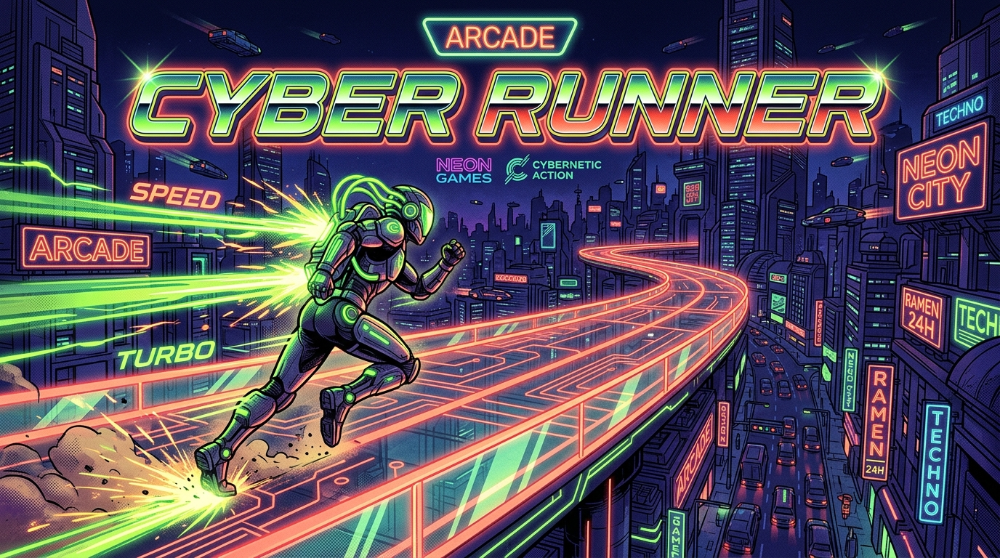

<div align="center">

# 🕹️ HUB.PLAY

**O seu destino arcade definitivo no navegador. Jogos autorais rápidos, modernos e com muito Juice.**

[](https://github.com/leonardoconstantino/hub-play/actions/workflows/deploy.yml)
[](https://react.dev/)
[](https://vitejs.dev/)
[](https://www.typescriptlang.org/)
[](https://tailwindcss.com/)
[](https://opensource.org/licenses/MIT)

### 🚀 [**JOGAR AGORA NA PRÉVIA ONLINE**](https://leonardoconstantino.github.io/hub-play/)

---



</div>

## 📖 Sobre o Projeto

O **HUB.PLAY** é um portal criado para conectar jogadores a uma coleção exclusiva de **15 jogos autorais e independentes** que rodam diretamente no navegador, sem necessidade de downloads ou instalações.

Inspirado na era de ouro dos fliperamas dos anos 80 e 90, o hub combina uma estética neon arcade moderna (fundo índigo profundo `#080B18`, verde-limão `#BFFF04` e coral `#FF5E5B`) com micro-interações táteis (*Juice*), áudio sintetizado em tempo real e performance ultrafluida.

---

## ✨ Principais Recursos

- 🌟 **Hero de Destaques Dinâmico**: Exibe automaticamente os jogos com flag `destaque: true` (como *BomberWeb*, *Synth Online*, *Void Crawler*, *Toque de Guerra*, *O Que Você Esqueceu* e *Jogo de Pesca*) com carrossel interativo e capa flutuante.
- ⚡ **Faixa de Letreiro Neon (Marquee)**: Faixa verde-limão inclinada com movimento contínuo ininterrupto exibindo slogans arcade.
- 🏷️ **Abas de Gênero Automáticas**: Categorias geradas dinamicamente a partir da taxonomia de `genero` (ex.: `"Ação / Arena"` gera a aba `"Ação"`).
- 🔍 **Busca em Tempo Real**: Filtro instantâneo por nome, subtítulo ou tags com estado vazio amigável caso nada seja encontrado.
- 🧃 **Puro "Juice" Visual**:
  - Efeito *shine sweep* (reflexo luminoso) passando sobre as capas.
  - Inclinação tátil alternada e elevação no hover (`-translate-y-2.5`).
  - Animação de pulo/bounce nos botões de reprodução `▶`.
  - Botão **JOGAR AGORA** com pulsos de luz e animação de clique realista.
- 🔊 **Sintetizador de Áudio Arcade (Web Audio API)**: Sons retro gerados proceduralmente para hovers, cliques e trocas de jogo, com botão para alternar mudo/som no cabeçalho.
- 📱 **Design 100% Responsivo**: Menu hambúrguer animado, controles táteis para telas de toque ($\ge 44\text{px}$) e conformidade com `prefers-reduced-motion`.
- 📁 **Arquitetura Orientada a Dados**: Todos os jogos são lidos de forma desacoplada em `data/games.json` e servidos de forma estática e segura.

---

## 🎮 Controles & Como Navegar

| Ação | Como Executar |
| :--- | :--- |
| **Explorar Jogos em Destaque** | Use os botões `<` e `>` ou as bolinhas no Hero principal. |
| **Jogar um Título** | Clique no botão **JOGAR AGORA** ou no ícone `▶` em qualquer card para abrir em nova aba. |
| **Filtrar por Categoria** | Clique em qualquer aba de gênero (*Ação*, *Ritmo*, *Puzzle*, *Simulação*, etc.). |
| **Pesquisar Título ou Mecânica** | Digite no campo de busca palavras-chave como `synthwave`, `retro`, `carros`, `física` ou `multiplayer`. |
| **Alternar Efeitos Sonoros** | Clique no ícone de alto-falante (🔊 / 🔇) no canto superior direito do cabeçalho. |
| **Conhecer Novidades ou Sobre** | Use os links **Novidades** ou **Sobre** no menu para abrir os modais informativos. |

---

## 💻 Como Rodar Localmente

### Pré-requisitos
- **Node.js** 20.x ou superior
- **npm** 9.x ou superior

### Passo a Passo

1. **Clone o repositório:**
   ```bash
   git clone https://github.com/leonardoconstantino/hub-play.git
   cd hub-play
   ```

2. **Instale as dependências:**
   ```bash
   npm install
   ```

3. **Inicie o servidor de desenvolvimento:**
   ```bash
   npm run dev
   ```
   Acesse a URL exibida no terminal (geralmente `http://localhost:3000` ou `http://localhost:5173`).

4. **Gerar a versão de produção (Build):**
   ```bash
   npm run build
   ```
   Os arquivos otimizados serão gerados no diretório `dist/`.

---

## 🚀 Deploy Automático no GitHub Pages

O projeto conta com uma esteira de entrega contínua (**CI/CD**) configurada no arquivo [`.github/workflows/deploy.yml`](.github/workflows/deploy.yml).

### Fluxo de Funcionamento:
1. Sempre que houver um `push` na branch `main` (ou `master`), o workflow do GitHub Actions é disparado automaticamente.
2. O ambiente Linux instala o **Node.js 20**, valida e compila o projeto passando `GITHUB_ACTIONS: true`.
3. O Vite ajusta o caminho base para `/hub-play/` de forma dinâmica.
4. Os artefatos estáticos de `dist/` são publicados de maneira nativa e segura no **GitHub Pages**.

> **Nota:** É possível também disparar o deploy manualmente a qualquer momento pela aba **Actions** > **Deploy to GitHub Pages** > **Run workflow**.

---

## 🛠️ Tecnologias Utilizadas

- **Framework**: [React 19](https://react.dev/)
- **Build Tool**: [Vite 8](https://vitejs.dev/)
- **Linguagem**: [TypeScript](https://www.typescriptlang.org/)
- **Estilização**: [Tailwind CSS v4](https://tailwindcss.com/)
- **Ícones**: [Lucide React](https://lucide.dev/)
- **Tipografia**: Google Fonts (*Bungee* e *Outfit*)
- **Efeitos Sonoros**: Web Audio API nativa do navegador
- **Hospedagem**: [GitHub Pages](https://pages.github.com/) via GitHub Actions

---

## 📄 Licença

Distribuído sob a licença **MIT**. Consulte o arquivo `LICENSE` para mais detalhes.

---

<div align="center">
  Desenvolvido com carinho e muito <i>Juice</i> por <a href="https://github.com/leonardoconstantino">Leonardo Constantino</a>.
</div>
